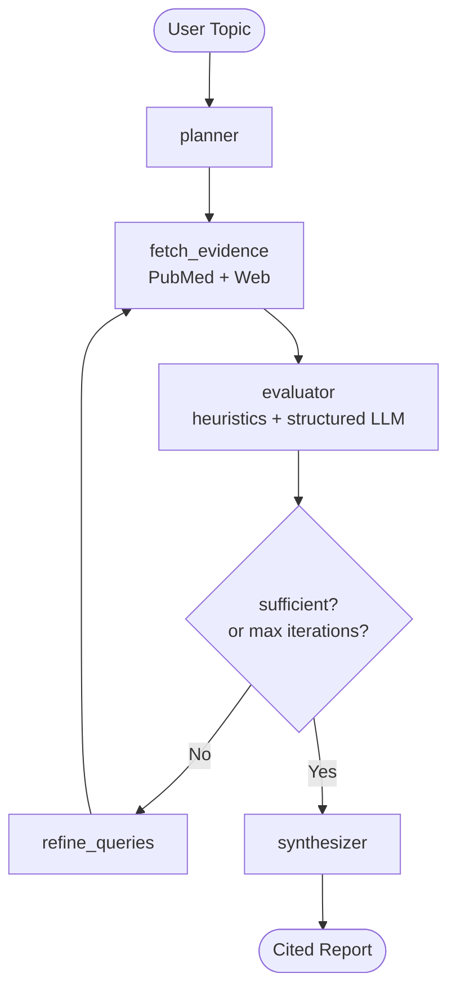

# MedGent Research Agent

> Autonomous deep-research agent for clinical literature — it plans a research
> strategy, gathers evidence from PubMed and the web, critiques study quality in
> a self-correcting loop, and synthesizes a cited report, streaming its reasoning
> to a web UI in real time.


> ⚠️ **Disclaimer**: This is a study/research tool. It does **not** provide medical
> advice, diagnosis, or treatment. Always consult a qualified professional.

<!-- TODO: add a screenshot / GIF of the reasoning timeline + report here. -->

---

## What it is

Most "chat with documents" demos do a single retrieval pass and call it a day.
MedGent is built around a **self-correcting research loop**: it decomposes a topic
into clinical sub-questions, retrieves evidence, *evaluates the quality of what it
found*, and decides on its own whether to dig deeper or write the report — all as a
**graph-based state machine** you can watch reason in real time.

It is a personal portfolio project with two explicit goals:

1. **Go deep** on LangGraph, agent state management, retrieval-augmented generation
   (structured *and* semantic), and clean architecture.
2. **Show engineering maturity** — typed state, a self-correcting agent loop,
   provider abstraction, a hexagonal core, and a real-time reasoning UI.

## Why it's interesting (the technical gist)

- **Self-correcting loop, not single-pass RAG** — a `planner → fetch → evaluate →
  refine/synthesize` graph that re-queries when the evidence is weak, bounded by an
  iteration ceiling.
- **Hybrid evaluator** — deterministic heuristics (study type, sample size,
  recency) *plus* structured LLM extraction (Pydantic), because small models should
  not be trusted to judge everything alone. The quality score is computed in code;
  the LLM only supplies the fields it is good at.
- **Hexagonal architecture (ports & adapters)** — a framework-free domain; LangGraph
  lives in the application layer and depends on ports, so PubMed, the LLM, and the
  web delivery are swappable adapters. The CLI and the HTTP API are two driving
  adapters over the *same* use case.
- **Structured *and* semantic RAG** — structured retrieval (NCBI Entrez / web) today,
  with embedding-based PDF search reserved behind the same port for later.
- **Provider-abstracted LLMs, free by default** — local **Ollama** out of the box
  (GPU-accelerated via Docker), with **Groq** / **Gemini** reserved behind the same
  port.
- **Reasoning you can see** — a React single-page app streams each step of the
  agent's thinking over Server-Sent Events: a thinking line per node, rich narration
  of each result, and the report typed out token by token.

## Architecture

The agent is a LangGraph state machine with a bounded self-correction loop:



📄 Full design and rationale: [`docs/architecture.md`](docs/architecture.md).
🐳 Run it locally (Ollama via Docker, API, UI): [`docs/running-locally.md`](docs/running-locally.md).
🗺️ Build log and backlog: [`docs/roadmap.md`](docs/roadmap.md).

## Tech stack

| Area | Choice |
| :--- | :--- |
| Agent orchestration | LangGraph (compiled with a `MemorySaver` checkpointer) |
| LLM (abstracted via `LLMPort`) | Ollama (default, real) · Groq · Gemini (stubs) |
| Structured retrieval | NCBI Entrez (PubMed, via `requests`) · DuckDuckGo (`ddgs`) |
| Semantic retrieval (future) | ChromaDB / FAISS |
| Validation / config | Pydantic v2 · pydantic-settings |
| API | FastAPI + Server-Sent Events (`sse-starlette`) |
| Front end | React 19 · Vite · TypeScript · Tailwind v4 (dark/light) · Framer Motion |
| Observability | native step trace in the UI · LangSmith (env key reserved) |
| Testing / tooling | pytest · ruff · uv · Vitest · ESLint · GitHub Actions |

## Repository layout (monorepo)

```
medgent-research-agent/
├── backend/        # Python — hexagonal core + LangGraph + FastAPI/CLI adapters
│   └── src/medgent/{domain,application,adapters}/
├── frontend/       # React + Vite single-page reasoning UI
├── docs/           # architecture, roadmap, running-locally
├── scripts/        # manual smoke test for the Ollama stack
├── docker-compose.yml   # local Ollama (GPU) server + auto model pull
└── LICENSE         # MIT
```

## Quickstart

**Prerequisites:** [Docker Desktop](https://www.docker.com/) (for Ollama),
[uv](https://docs.astral.sh/uv/) (Python), and [Node.js](https://nodejs.org/) 20+
(frontend). An NVIDIA GPU is recommended — see the note in
[`docs/running-locally.md`](docs/running-locally.md).

Three terminals:

```bash
# 1 — Local LLM (from the repo root). Auto-pulls the model on first run.
docker compose up -d
docker compose logs -f ollama-init   # wait for the model pull to finish

# 2 — Backend API (from backend/). Serves http://localhost:8000
cd backend
uv sync
./serve.ps1                          # Windows; or: uv run uvicorn medgent.adapters.driving.api.app:create_app --factory --port 8000

# 3 — Frontend (from frontend/). Opens http://localhost:5173
cd frontend
npm install
npm run dev
```

Open the Vite URL, enter a clinical topic, and watch the agent work.

Prefer the terminal? The backend also ships a CLI:

```bash
cd backend
./run.ps1 "efficacy of metformin for type 2 diabetes"
# Windows; cross-platform equivalent: PYTHONPATH=src uv run python -m medgent "..."
```

> **Note (Windows, non-ASCII home path):** if `python -m medgent` reports
> `No module named 'medgent'`, it is the editable-install `.pth` encoding bug —
> use the `run.ps1`/`serve.ps1` wrappers (they set `PYTHONPATH=src`). Details in
> [`docs/running-locally.md`](docs/running-locally.md).

## Roadmap

- [x] Hexagonal backend scaffolding (uv, ruff, pytest, CI)
- [x] Agent state + Pydantic schemas (domain)
- [x] LLM provider abstraction (Ollama real; Groq/Gemini stubs)
- [x] Retrieval adapters — PubMed + web search behind one port
- [x] Graph nodes + self-correction loop + checkpointer
- [x] Synthesizer + end-to-end CLI
- [x] Docker + Ollama (GPU) local LLM infrastructure
- [x] FastAPI streaming (SSE) API
- [x] React single-page reasoning UI (dark/light, animated timeline)
- [ ] Implement the Groq / Gemini adapters for real (free-tier, no GPU needed)
- [ ] Split the compose GPU reservation into an optional override file
- [ ] Frontend CI job (lint + test + build + contrast)
- [ ] LangSmith tracing integration
- [ ] Persistent checkpointer (SQLite) + conversational follow-up mode

See [`docs/roadmap.md`](docs/roadmap.md) for the full backlog with context.

## License

[MIT](LICENSE) © Pedro Lucas

## Built with

Developed with [Kiro](https://kiro.dev), an agentic AI development environment,
used throughout the project as a pair-programming and implementation tool.
