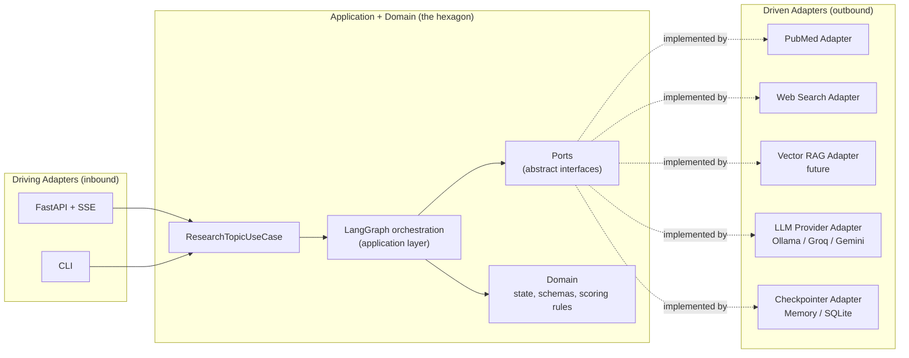

# MedGent Research Agent — System Architecture

An autonomous, multi-step agent that conducts systematic literature reviews and
evidence extraction over medical databases (PubMed) and the open web, orchestrated
with **LangGraph** and exposed through a **React single-page app** backed by a
**FastAPI** streaming API.

The project is a personal portfolio piece. Its goals are twofold:

1. **Learning**: go deep on LangGraph, agent state management, retrieval-augmented
   generation (both *structured* and *semantic*), and clean software architecture
   (**hexagonal / ports & adapters**).
2. **Signal**: demonstrate engineering maturity beyond a basic demo — typed state,
   a self-correcting agent loop, provider abstraction, a hexagonal core, and a
   real-time reasoning UI.

> ⚠️ **Disclaimer**: This is a study/research tool. It does **not** provide medical
> advice, diagnosis, or treatment recommendations.

---

## 1. High-Level Overview

Unlike a single-pass RAG pipeline, this system implements a **self-correcting
research loop** built as a graph-based state machine. It plans a research strategy,
retrieves evidence from multiple sources, evaluates study quality with a hybrid
heuristic + LLM approach, and iteratively refines its queries until evidence
criteria are met or an iteration ceiling is reached.


### A note on RAG terminology

The whole pipeline is, in essence, **agentic RAG** — retrieval augmenting
generation. What varies is the *retrieval mechanism*:

- **Structured retrieval** (MVP): a structured query against an external system
  (NCBI Entrez / web search). No embeddings, but still retrieval that augments the
  LLM's context.
- **Semantic retrieval** (future extension): embedding-based similarity search over
  ingested clinical PDFs (ChromaDB/FAISS).

Both are exposed through the same **`EvidenceRetrievalPort`**, so adding semantic RAG
later requires **no change to the domain** — only a new driven adapter.

---

## 2. Architecture: Hexagonal (Ports & Adapters)

The codebase follows a **pragmatic hexagonal architecture**. The domain and
application layers never import frameworks, HTTP, or external SDKs. All I/O crosses
the boundary through **ports** (interfaces) implemented by **adapters**.



### Design decision: where does LangGraph live?

LangGraph is an opinionated orchestration framework. A *purist* hexagonal design
would keep the core free of it entirely. We instead take a **pragmatic** stance,
documented deliberately:

- LangGraph lives in the **application layer** (it orchestrates the use case).
- The graph **nodes depend on ports**, never on concrete adapters. A node asks an
  `EvidenceRetrievalPort` for evidence; it does not know PubMed, Ollama, or FastAPI
  exist.
- The **domain layer** (state shape, Pydantic schemas, scoring heuristics) has zero
  framework imports and is unit-testable in isolation.

This keeps the valuable property of hexagonal — a core decoupled from I/O and
delivery — without fighting the framework. The trade-off is intentional and is
itself part of what this project demonstrates.

### Source layout

```
backend/src/medgent/
├── domain/            # state (TypedDict) + Pydantic schemas + scoring rules (no frameworks)
├── application/
│   ├── ports/         # EvidenceRetrievalPort, LLMPort, CheckpointerPort
│   ├── use_cases/     # ResearchTopicUseCase
│   └── graph/         # LangGraph nodes, routing, build (depend on ports)
└── adapters/
    ├── driving/       # FastAPI (+ SSE), CLI
    └── driven/        # PubMed, web search, LLM providers, checkpointers
```

### Ports (interfaces owned by the core)

| Port | Responsibility | MVP Adapters | Future Adapters |
| :--- | :--- | :--- | :--- |
| `EvidenceRetrievalPort` | Return normalized evidence for a query | `PubMedAdapter`, `WebSearchAdapter` | `VectorRagAdapter` (PDF semantic search) |
| `LLMPort` | Text + structured output (`generate`, `generate_structured`) | `OllamaAdapter` (real); `GroqAdapter`, `GeminiAdapter` (stubs) | — |
| `CheckpointerPort` | Persist/restore graph state by `thread_id` | `MemoryCheckpointer`, `SqliteCheckpointer` | — |

### Driving adapters

Both the **FastAPI** endpoint and the **CLI** invoke the *same*
`ResearchTopicUseCase`. This proves the architecture pays off: one core, multiple
delivery mechanisms, no duplicated logic.

---

## 3. State Management

State flows between nodes as a typed structure. The graph state is a
`TypedDict` (`AgentState`); the *items* inside it are validated **Pydantic v2**
models. This is the pragmatic, idiomatic LangGraph pattern.

| Field | Type | Description |
| :--- | :--- | :--- |
| `topic` | `str` | Original research topic from the user. |
| `queries` | `list[str]` | Generated search strings optimized for PubMed/MeSH and web. |
| `evidence` | `list[Evidence]` | Raw, normalized results from all retrieval sources. |
| `evaluated_studies` | `list[EvaluatedStudy]` | Filtered evidence with extracted N, study type, key finding, relevance, and score. |
| `iteration` | `int` | Loop counter; guards against infinite re-querying. |
| `max_iterations` | `int` | Ceiling for the self-correction loop (default: 3). |
| `is_sufficient` | `bool` | Set by the evaluator to trigger synthesis. |
| `final_report` | `str` | Structured markdown report with inline citations. |

### Pydantic schemas (domain)

- **`Evidence`** — source-agnostic retrieved item (`source`, `identifier`, `title`,
  `abstract`, `authors`, `year`, `url`). The common shape every retrieval adapter
  normalizes to.
- **`EvaluatedStudy`** — structured output of the evaluator (`identifier`,
  `study_type`, `sample_size`, `key_finding`, `relevance_score`, `quality_score`).
- **`QueryPlan`** — structured output of the planner (`queries`, `rationale`).
- Enums: **`EvidenceSource`** (`pubmed` / `web`) and **`StudyType`**.

### Persistence & the path to conversational follow-ups

The graph is **compiled with a checkpointer** and keyed by a `thread_id` from day
one. In the MVP this powers robustness and step streaming. It is also the
foundation for a **future "hybrid / follow-up" mode**: a follow-up question becomes
*resuming the same thread* with new input, rather than a rewrite. No MVP UI exposes
this yet, but the architecture reserves the door.

---

## 4. Nodes and Logic

| Node | Input | Responsibility | State Changes |
| :--- | :--- | :--- | :--- |
| `planner` | `topic` | Decompose the topic into targeted clinical sub-queries (e.g. mechanism of action, efficacy, adverse effects) via structured output (`QueryPlan`). | `queries` |
| `fetch_evidence` | `queries` | Run retrieval ports (PubMed + web), normalize and deduplicate results. | `evidence` |
| `evaluator` | `evidence` | Hybrid evaluation (below). Decide sufficiency or flag the need for query expansion. | `evaluated_studies`, `is_sufficient`, `iteration` |
| `refine_queries` | `evaluated_studies` | Reformulate queries targeting the gaps found by the evaluator. | `queries` |
| `synthesizer` | `evaluated_studies` | Compile validated findings into a systematic review with inline citations and a disclaimer. | `final_report` |

### The evaluator: hybrid scoring (heuristics + LLM)

A key engineering lesson baked into the design: **do not delegate everything to the
LLM**, especially small local models. The evaluator combines three stages:

1. **Deterministic heuristics (code)** — cheap, reliable filters: is there an
   abstract? is the publication year reasonable? is a study type detectable from
   metadata? is a minimum sample size present when available?
2. **Structured LLM extraction (Pydantic)** — for the evidence that passes, the LLM
   extracts an `EvaluatedStudy` constrained to a validated schema via
   `generate_structured` / `with_structured_output`.
3. **Combined score** — heuristic signals and LLM relevance combine into a single
   `quality_score` compared against a threshold to set `is_sufficient`.

---

## 5. Self-Correction Loop (Conditional Routing)

Routing after `evaluator` (`add_conditional_edges`):

1. `is_sufficient == True` **OR** `iteration >= max_iterations` → `synthesizer`.
2. `is_sufficient == False` **AND** `iteration < max_iterations` → `refine_queries`
   → `fetch_evidence`.

---

## 6. Real-Time Reasoning UI

The front end is a **React single-page application** (Vite + TypeScript + Tailwind,
dark mode by default, tasteful motion) whose purpose is to make the agent's
reasoning *visible*.

- **Transport**: the FastAPI driving adapter consumes `graph.stream(...)` and relays
  each node update to the browser over **Server-Sent Events (SSE)**.
- **What the user sees**:
  - A reasoning timeline that animates as each node runs (queries generated, papers
    found, evaluator decision, current iteration of the loop).
  - An expandable panel showing the structured graph state at each step.
  - The final report rendered with expandable, traceable citations (PMID / URL).
  - A persistent medical disclaimer.

Single-page is the right fit: the interaction is essentially one screen (topic input
→ reasoning timeline → report), so no complex routing is needed.

---

## 7. Repository Layout (Monorepo)

```
medgent-research-agent/
├── backend/        # Python — hexagonal core + LangGraph + FastAPI/CLI adapters
├── frontend/       # React + Vite single-page reasoning UI
├── docs/           # architecture, roadmap, design notes
└── README.md
```

---

## 8. Tech Stack

- **Orchestration**: LangGraph (compiled with a checkpointer).
- **LLM (provider-abstracted via `LLMPort`)**:
  - Default **Ollama** (`qwen2.5:7b` / `llama3.2:3b`) — local, zero cost, offline.
    Run via Docker (see `docs/roadmap.md`).
  - Optional free-tier APIs: **Groq** (Llama 3.3 70B) and **Google Gemini**
    (2.0 Flash), selected by config/env. Keeps the project free while allowing
    high-quality synthesis. (Groq/Gemini adapters are stubs until implemented.)
- **Structured retrieval**: NCBI Entrez (BioPython or `requests`) + DuckDuckGo Search.
- **Semantic retrieval (future)**: ChromaDB / FAISS over ingested PDFs.
- **Validation / config**: Pydantic v2 + pydantic-settings.
- **API**: FastAPI with SSE streaming.
- **Front end**: React + Vite + TypeScript + Tailwind (dark mode default, animated).
- **Observability**: native structured step trace in the UI; **LangSmith** optional
  via env var (free tier), disabled gracefully when absent.
- **Testing**: pytest (external APIs mocked); front-end stream-formatting logic tested
  in isolation from rendering.
- **Tooling**: uv for Python deps; ruff for lint/format; GitHub Actions CI.

---

## 9. Out of Scope (Documented Future Extensions)

- **Hybrid / follow-up conversational mode** — enabled by the checkpointer foundation.
- **Semantic RAG over local PDFs** — new `VectorRagAdapter` behind the existing port.
- **Higher medical rigor** — evidence pyramid (meta-analysis > RCT > observational)
  and PICO extraction.
- **Containerization** — Docker Compose stack (Ollama + backend + frontend); see
  `docs/roadmap.md`.
