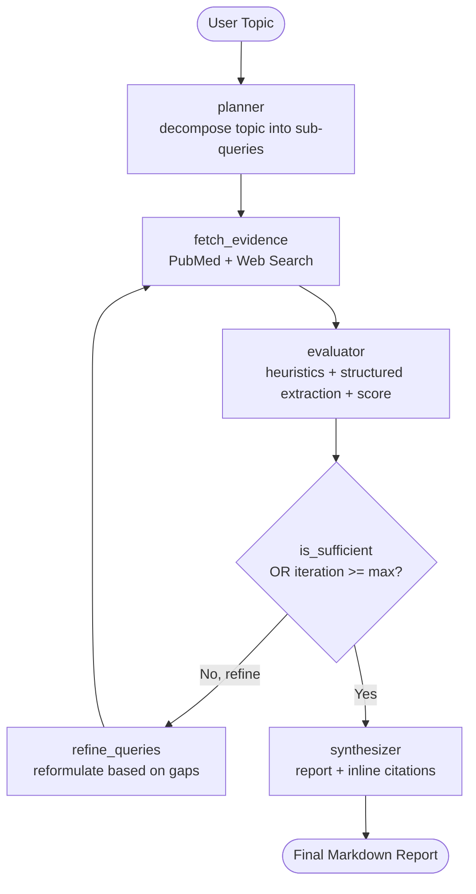
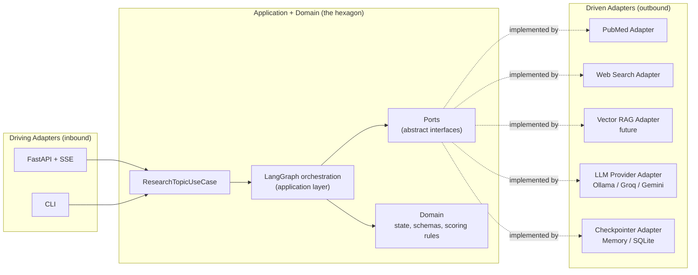

# MedGent Research Agent — System Architecture

An autonomous, multi-step agent that conducts systematic literature reviews and
evidence extraction over medical databases (PubMed) and the open web, orchestrated
with **LangGraph** and exposed through a **React single-page app** backed by a
**FastAPI** streaming API.

The project is a personal portfolio piece. Its goals are twofold:

1. **Learning**: go deep on LangGraph, agent state management, retrieval-augmented
   generation (both *structured* and *semantic*), and clean software architecture
   (**hexagonal / ports & adapters**).
2. **Signal**: demonstrate engineering maturity beyond a basic demo — typed state,
   a self-correcting agent loop, provider abstraction, a hexagonal core, and a
   real-time reasoning UI.

> ⚠️ **Disclaimer**: This is a study/research tool. It does **not** provide medical
> advice, diagnosis, or treatment recommendations.

---

## 1. High-Level Overview

Unlike a single-pass RAG pipeline, this system implements a **self-correcting
research loop** built as a graph-based state machine. It plans a research strategy,
retrieves evidence from multiple sources, evaluates study quality with a hybrid
heuristic + LLM approach, and iteratively refines its queries until evidence
criteria are met or an iteration ceiling is reached.



### A note on RAG terminology

The whole pipeline is, in essence, **agentic RAG** — retrieval augmenting
generation. What varies is the *retrieval mechanism*:

- **Structured retrieval** (MVP): a structured query against an external system
  (NCBI Entrez / web search). No embeddings, but still retrieval that augments the
  LLM's context.
- **Semantic retrieval** (future extension): embedding-based similarity search over
  ingested clinical PDFs (ChromaDB/FAISS).

Both are exposed through the same **`EvidenceRetrievalPort`**, so adding semantic RAG
later requires **no change to the domain** — only a new driven adapter.

---

## 2. Architecture: Hexagonal (Ports & Adapters)

The codebase follows a **pragmatic hexagonal architecture**. The domain and
application layers never import frameworks, HTTP, or external SDKs. All I/O crosses
the boundary through **ports** (interfaces) implemented by **adapters**.



### Design decision: where does LangGraph live?

LangGraph is an opinionated orchestration framework. A *purist* hexagonal design
would keep the core free of it entirely. We instead take a **pragmatic** stance,
documented deliberately:

- LangGraph lives in the **application layer** (it orchestrates the use case).
- The graph **nodes depend on ports**, never on concrete adapters. A node asks an
  `EvidenceRetrievalPort` for evidence; it does not know PubMed, Ollama, or FastAPI
  exist.
- The **domain layer** (state shape, Pydantic schemas, scoring heuristics) has zero
  framework imports and is unit-testable in isolation.

This keeps the valuable property of hexagonal — a core decoupled from I/O and
delivery — without fighting the framework. The trade-off is intentional and is
itself part of what this project demonstrates.

### Source layout

```
backend/src/medgent/
├── domain/            # state (TypedDict) + Pydantic schemas + scoring rules (no frameworks)
├── application/
│   ├── ports/         # LLMPort, EvidenceRetrievalPort
│   ├── retrieval/     # aggregate_evidence (multi-source helper)
│   ├── use_cases/     # ResearchTopicUseCase (run / stream / stream_events)
│   └── graph/         # LangGraph nodes, routing, build (depend on ports)
└── adapters/
    ├── driving/       # api/ (FastAPI + SSE), cli.py, composition.py
    └── driven/        # llm/ (Ollama/Groq/Gemini), retrieval/ (PubMed/web)
```

### Ports (interfaces owned by the core)

| Port | Responsibility | Adapters | Future Adapters |
| :--- | :--- | :--- | :--- |
| `LLMPort` | Text + structured output (`generate`, `generate_structured`) | `OllamaAdapter` (real); `GroqAdapter`, `GeminiAdapter` (stubs) | — |
| `EvidenceRetrievalPort` | Return normalized `Evidence` for a query (`search`) | `PubMedAdapter`, `WebSearchAdapter` | `VectorRagAdapter` (PDF semantic search) |

> **Checkpointer — no formal port (deliberate).** The graph is compiled with a
> checkpointer, but we do **not** wrap it in a `CheckpointerPort`: LangGraph already
> abstracts over interchangeable savers (`MemorySaver`, `SqliteSaver`), so an extra
> port would be redundant ceremony. `build_graph` takes an optional checkpointer
> (default `MemorySaver`). A SQLite saver for persistence/follow-ups is future work.

### Driving adapters

Both the **FastAPI** API and the **CLI** build concrete adapters and invoke the
*same* `ResearchTopicUseCase` — the shared wiring lives in
`adapters/driving/composition.py`. This proves the architecture pays off: one core,
multiple delivery mechanisms, no duplicated logic. The driving adapters are the
**only** place concrete adapters are instantiated (the composition root).

---

## 3. State Management

State flows between nodes as a typed structure. The graph state is a
`TypedDict` (`AgentState`); the *items* inside it are validated **Pydantic v2**
models. This is the pragmatic, idiomatic LangGraph pattern.

| Field | Type | Description |
| :--- | :--- | :--- |
| `topic` | `str` | Original research topic from the user. |
| `queries` | `list[str]` | Generated search strings optimized for PubMed/MeSH and web. |
| `evidence` | `list[Evidence]` | Raw, normalized results from all retrieval sources. |
| `evaluated_studies` | `list[EvaluatedStudy]` | Filtered evidence with extracted N, study type, key finding, relevance, and score. |
| `iteration` | `int` | Loop counter; guards against infinite re-querying. |
| `max_iterations` | `int` | Ceiling for the self-correction loop (default: 3). |
| `is_sufficient` | `bool` | Set by the evaluator to trigger synthesis. |
| `final_report` | `str` | Structured markdown report with inline citations. |

### Pydantic schemas (domain)

- **`Evidence`** — source-agnostic retrieved item (`source`, `identifier`, `title`,
  `abstract`, `authors`, `year`, `url`). The common shape every retrieval adapter
  normalizes to.
- **`QueryPlan`** — structured output of the planner (`queries`, `rationale`).
- **`StudyExtraction`** — the fields the LLM is asked to extract per study
  (`study_type`, `sample_size`, `key_finding`, `relevance_score`). It deliberately
  **omits** `identifier` and `quality_score`.
- **`StudyBatchExtraction`** — `{ studies: list[StudyExtraction] }`, the batch form
  the LLM returns when several studies are extracted in one call.
- **`EvaluatedStudy`** — the evaluator's final record: the extracted fields plus the
  two the application owns — `identifier` (copied from the source `Evidence`) and
  `quality_score` (computed in code). Never fully trusted to the model.
- Enums: **`EvidenceSource`** (`pubmed` / `web`) and **`StudyType`**.

> **Why `StudyExtraction` is separate from `EvaluatedStudy`.** `EvaluatedStudy`
> constrains `quality_score` to `[0, 1]`. Early on the LLM was asked for the whole
> `EvaluatedStudy` and small models returned out-of-range scores (e.g. `2.5`),
> failing validation before the code could override them. Splitting out
> `StudyExtraction` means the model is only ever asked for the fields it should
> decide; `identifier` and `quality_score` are set in code afterwards.

### Persistence & the path to conversational follow-ups

The graph is **compiled with a checkpointer** and keyed by a `thread_id` from day
one. In the MVP this powers robustness and step streaming. It is also the
foundation for a **future "hybrid / follow-up" mode**: a follow-up question becomes
*resuming the same thread* with new input, rather than a rewrite. No MVP UI exposes
this yet, but the architecture reserves the door.

---

## 4. Nodes and Logic

| Node | Input | Responsibility | State Changes |
| :--- | :--- | :--- | :--- |
| `planner` | `topic` | Decompose the topic into targeted clinical sub-queries (e.g. mechanism of action, efficacy, adverse effects) via structured output (`QueryPlan`), capped at **5 queries** in code. | `queries` |
| `fetch_evidence` | `queries` | Run retrieval ports (PubMed + web), normalize and deduplicate results. | `evidence` |
| `evaluator` | `evidence` | Hybrid evaluation (below). Decide sufficiency or flag the need for query expansion. | `evaluated_studies`, `is_sufficient`, `iteration` |
| `refine_queries` | `evaluated_studies` | Reformulate queries targeting the gaps found by the evaluator (also capped at 5). | `queries` |
| `synthesizer` | `evaluated_studies` | Compile validated findings into a systematic review with inline citations and a disclaimer. | `final_report` |

### The evaluator: hybrid scoring (heuristics + LLM)

A key engineering lesson baked into the design: **do not delegate everything to the
LLM**, especially small local models. The evaluator combines three stages:

1. **Deterministic heuristics (code)** — a pure `heuristic_score(evidence)` in the
   domain: is there an abstract? is the publication year recent? is the abstract
   substantial? Cheap, reliable, explainable.
2. **Structured LLM extraction (Pydantic)** — for the evidence that passes, the LLM
   extracts a `StudyExtraction` (not the full `EvaluatedStudy`) via
   `generate_structured` / `with_structured_output`.
3. **Combined score (code)** — `combine_scores(heuristic, relevance)` blends the
   heuristic with the LLM's relevance into the final `quality_score`. Sufficiency is
   a threshold-plus-count rule: `is_sufficient` once at least `min_studies` have
   `quality_score ≥ quality_threshold`.

**Cost controls.** The evaluator only scores the top `max_studies_per_iteration`
(default 12, ranked by heuristic) and extracts them in **batches** (default 3 per
LLM call) via `StudyBatchExtraction`, falling back to one-at-a-time if a batch call
fails or returns the wrong count. Together with the planner's 5-query cap, this
keeps a local-model run tractable.

---

## 5. Self-Correction Loop (Conditional Routing)

Routing after `evaluator` (`add_conditional_edges`):

1. `is_sufficient == True` **OR** `iteration >= max_iterations` → `synthesizer`.
2. `is_sufficient == False` **AND** `iteration < max_iterations` → `refine_queries`
   → `fetch_evidence`.

---

## 6. HTTP API & SSE streaming

The FastAPI driving adapter (`adapters/driving/api/`) exposes:

- `GET /health` → `{"status": "ok"}`.
- `POST /research` → runs the loop synchronously and returns the final report JSON
  (`{topic, report, iterations, studies}`). Simple, but blocks for the whole run.
- `GET /research/stream?topic=…[&max_iterations=…]` → **Server-Sent Events**, the
  interactive path the UI uses.

### SSE event contract

The use case's `stream_events()` runs the compiled graph with LangGraph's combined
`stream_mode=["updates", "messages", "debug"]` and normalizes it into events the API
relays as named SSE events:

| `event:` | `data` (JSON) | Meaning |
| :--- | :--- | :--- |
| `node_start` | `{node}` | a node began (from debug task-start) — drives the "thinking" line |
| `step` | `{node, summary, keys, data}` | a node finished; `data` is the JSON-safe state update |
| `token` | `{node: "synthesizer", text}` | a chunk of the report as it's written |
| `done` | `{topic, report, iterations, studies}` | terminal success |
| `error` | `{error, detail}` | the run raised; the stream then ends |

Token events are filtered to the **synthesizer** only (the other nodes emit
structured JSON, uninteresting as tokens — their `step` narration covers them).

### Off-thread bridge (don't block the event loop)

`graph.stream(...)` is a **synchronous, blocking** generator. Iterating it directly
inside the async SSE handler would freeze the asyncio event loop, so `sse-starlette`
could neither flush events nor send heartbeats and clients would time out. The API
therefore runs the sync generator in a worker thread (`anyio.to_thread.run_sync`)
and hands each event to the async side through an `asyncio.Queue`, keeping the loop
free to deliver events incrementally.

## 7. Real-Time Reasoning UI

The front end is a **React single-page application** (Vite + TypeScript + Tailwind
v4 + Framer Motion) whose purpose is to make the agent's reasoning *visible*.

- **Themes**: dark (default) and light, toggled in-header and persisted in
  `localStorage`; an inline pre-React script sets the theme to avoid a flash.
- **Named-event consumption**: the native `EventSource` registers one listener per
  event name (`node_start`/`step`/`token`/`done`/`error`); the parsed events feed a
  **pure reducer** (`reasoningReducer.ts`) kept separate from rendering and unit-
  tested with Vitest. The connection closes on `done`/`error`/unmount/new-run.
- **What the user sees**:
  - A reasoning timeline where each node shows a "thinking" line while it runs, then
    flips to a rich narration of its result (the queries, the paper count, the
    evaluator's iteration/decision) — not raw JSON.
  - The report rendered as Markdown, typed out token by token, with linkified PMIDs
    and URLs.
  - A collapsible "Sources" panel of evaluated studies (type badge, quality meter,
    PubMed link).
  - Post-run actions (New research / Run again / Copy / Download), keyboard
    shortcuts, a centered auto-scrolling layout, and a persistent disclaimer.
- **Look**: a calm deep-navy "dusk" palette with a single soft periwinkle accent,
  glass surfaces, a faint blueprint grid, and a low-alpha ambient glow; all decorative
  motion is disabled under `prefers-reduced-motion`.

Single-page is the right fit: the interaction is essentially one screen (topic input
→ reasoning timeline → report), so no complex routing is needed.

---

## 8. Repository Layout (Monorepo)

```
medgent-research-agent/
├── backend/        # Python — hexagonal core + LangGraph + FastAPI/CLI adapters
├── frontend/       # React + Vite single-page reasoning UI
├── docs/           # architecture, roadmap, running-locally
├── scripts/        # manual Ollama smoke test
├── docker-compose.yml
└── README.md
```

---

## 9. Tech Stack

- **Orchestration**: LangGraph (compiled with a `MemorySaver` checkpointer).
- **LLM (provider-abstracted via `LLMPort`)**:
  - Default **Ollama** (`qwen2.5:7b` / `llama3.2:3b`) — local, zero cost, offline,
    GPU-accelerated. Run via Docker (see `docs/running-locally.md`).
  - **Groq** and **Google Gemini** adapters exist as stubs behind the same port,
    to be implemented when needed.
- **Structured retrieval**: NCBI Entrez (`requests`) + DuckDuckGo Search (`ddgs`).
- **Semantic retrieval (future)**: ChromaDB / FAISS over ingested PDFs.
- **Validation / config**: Pydantic v2 + pydantic-settings.
- **API**: FastAPI with SSE streaming (`sse-starlette`).
- **Front end**: React 19 + Vite + TypeScript + Tailwind v4 + Framer Motion
  (dark/light themes).
- **Observability**: native reasoning timeline in the UI; **LangSmith** env key
  reserved (integration is future work).
- **Testing**: pytest (external APIs mocked); front-end reducer + theme logic tested
  with Vitest, in isolation from rendering.
- **Tooling**: uv for Python deps; ruff for lint/format; ESLint; GitHub Actions CI
  (backend; a frontend job is planned).

---

## 10. Out of Scope (Documented Future Extensions)

See [`docs/roadmap.md`](roadmap.md) for the full backlog. Highlights:

- **Hybrid / follow-up conversational mode** — enabled by a persistent checkpointer.
- **Real Groq / Gemini adapters** — currently stubs; a free alternative to a local GPU.
- **Semantic RAG over local PDFs** — new `VectorRagAdapter` behind the existing port.
- **Higher medical rigor** — evidence pyramid (meta-analysis > RCT > observational)
  and PICO extraction.
- **Containerization** — Docker Compose stack (Ollama + backend + frontend).
